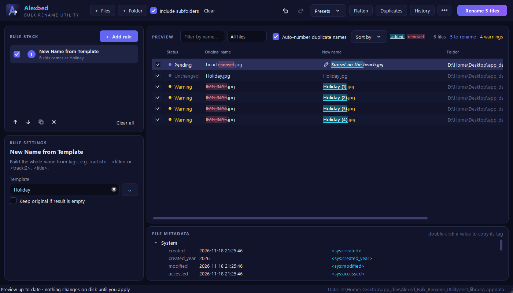
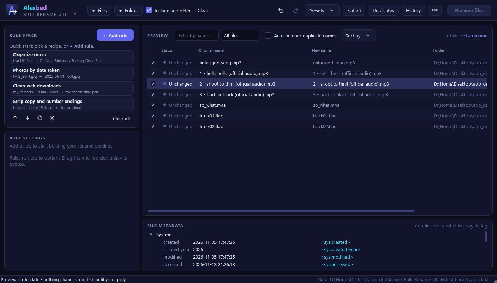
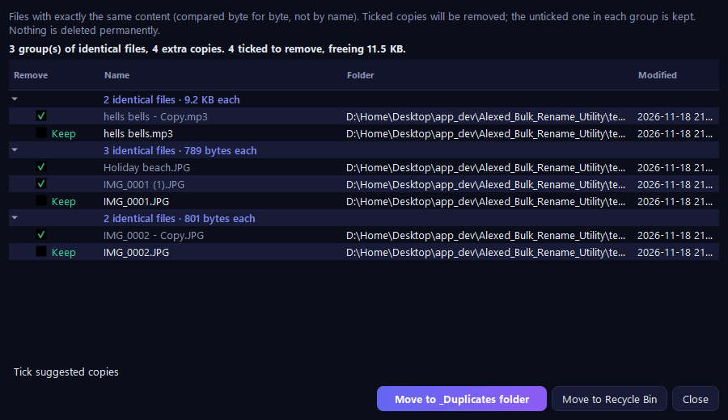
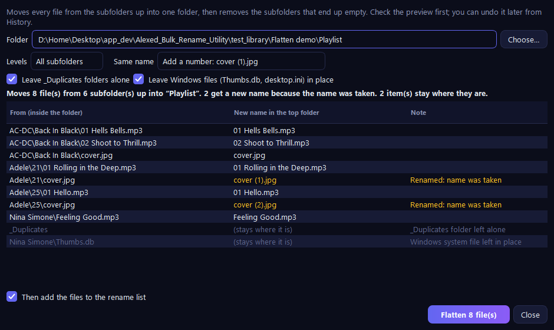
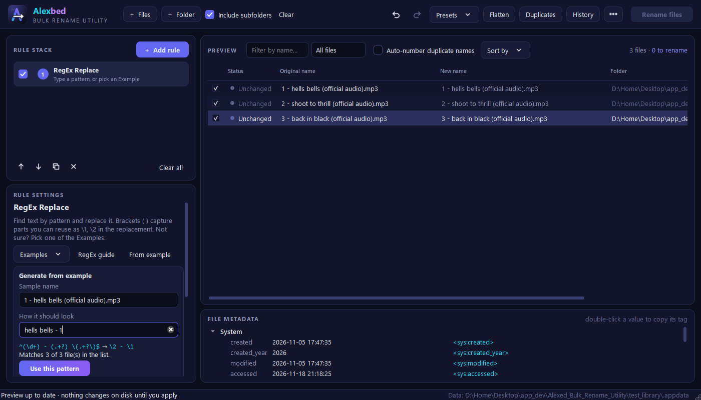
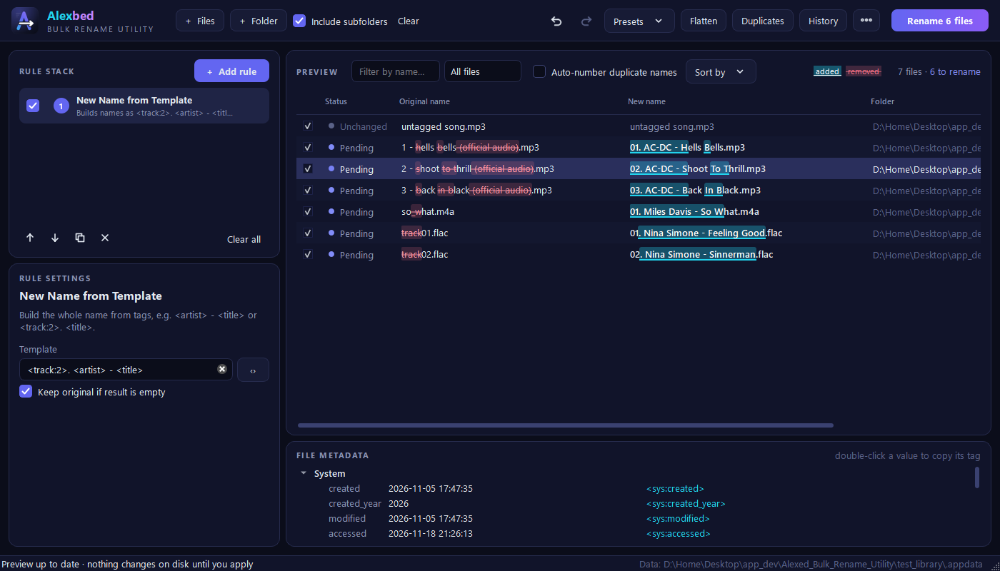

# Alexbed Bulk Rename Utility


A portable, transactional bulk file renamer for big music libraries, photo and video folders and deeply nested document archives.
It's a single `.exe` for Windows 10/11, with no installer and no registry footprint.

**Version:** 1.3.0 &nbsp;|&nbsp; **Author:** Alexander Bediako &nbsp;|&nbsp; **Licence:** [GPL-3.0-or-later](LICENSE)

> Versions 1.0.0 and 1.1.0 were published under the misspelt name *Alexed*. The app is **Alexbed**; old links
> redirect here, and an existing `AlexedBRU_data` folder keeps being used, so your history and settings stay.


- **See every change before it happens.** The preview updates as you type. Added text is highlighted in cyan, and removed text is struck through in red.
- **Nothing touches the disk until you press Rename.** Renames run as one transaction: if anything fails, everything is rolled back.
- **Undo any batch later,** even after closing the app.
- **Rename from tags:** ID3/FLAC/MP4 audio tags, video tags, EXIF dates and PDF/Office properties.
- **Fast with big folders:** 10,000 files preview in a fraction of a second.
- **No RegEx needed:** show one example of the name you want and the pattern is written for you. Every rule card says in plain English what it does.
- **Fix single files by hand:** double-click a new name to type your own.
- **Find duplicate files** by content, not by name, and set the extra copies aside safely.
- **Flatten folders:** bring every file up out of its subfolders into one folder, with a preview and undo.

## How-to video

New to the app? Watch the 3-minute narrated walkthrough:
**[Alexbed-Bulk-Rename-Utility-how-to.mp4](https://github.com/alexbedca/Alexbed-Bulk-Rename-Utility/releases/latest/download/Alexbed-Bulk-Rename-Utility-how-to.mp4)**
(1080p, 8 MB, with subtitles). It covers adding files and rules, the preview, RegEx from an example,
hand-edited names, auto-numbering, rename and undo, finding duplicates, tag-based names and the Send To menu.
It's built from real screenshots by `tools\make_tutorial_video.py`.

## Download

Get `AlexbedBulkRename.exe` from the [latest release](../../releases/latest) and run it. No install is needed.
Windows SmartScreen may warn about an unknown publisher, because the exe isn't code-signed. Choose *More info → Run anyway*.

## Run from source

```powershell
python -m venv .venv
.venv\Scripts\pip install -r requirements-dev.txt
.venv\Scripts\python run.py            # or: python -m alexed_bru
```

To build the portable executable (runs the tests first), run `build.ps1`. The output is `dist\AlexbedBulkRename.exe`:

```powershell
powershell -ExecutionPolicy Bypass -File build.ps1
```

History, presets and settings are stored in `AlexbedBRU_data\` next to the exe (or in an existing `AlexedBRU_data\` from 1.1.0 or older). Copy both together to take your setup to another PC.
Set `ALEXBED_BRU_DATA` to store them somewhere else.

**Privacy:** the app writes no log, crash or debug files and sends nothing over the network. Its data folder only
holds your rename history, presets and settings; **History → Clear history** forgets all rename records at any
time. (Like any single-file app, the exe unpacks its own program files to a temporary folder while it runs and
removes them when it closes.)

## Using it

1. Drop files or folders onto the window (subfolders are included if that box is ticked).
2. Add rules on the left. They run top to bottom. Drag to reorder, untick to bypass.
   Each rule card says what it does in plain English, for example *Replaces "_" with a space* or *Adds "2026 - " to the start*.
3. The preview updates as you type:
   - *New name*: added or changed characters are highlighted in **cyan**.
   - *Original name*: characters that will be removed are **struck through in red**.
   - While a RegEx or Find & Replace rule is selected, *Original name* shows what it matches instead, with each capture group in its own colour.
   - Status dots: blue = will rename, amber = warning, red = error (skipped).
4. Click **Rename N files**. You can undo any batch later from **History**, even after restarting the app.

### Edit one file's name by hand

Double-click a *New name* (or select it and press F2), type the name you want and press Enter.
That file then ignores the rules: its name shows in *italics* with a ✎ pencil, and *Details* says "Edited by hand".
Counters still count it, so other files keep their numbers. Hand-typed names get the same checks as any other
(no invalid characters, no duplicates), and renaming and undo work as usual.
To let the rules decide again, right-click → **Reset to rule name**, or clear the text.

### Duplicate names

If two files would end up with the same name, both show a red error and are skipped. Tick
**Auto-number duplicate names** (above the preview) to number them instead: the first keeps the name and the
others become `photo (1).jpg`, `photo (2).jpg` and so on, skipping numbers already used in the folder.
Numbered rows show in amber. This setting is remembered.



### Quick recipes

With no rules yet, the rule list shows four one-click recipes, each with a live example from your first file:
**Organize music** (`01. Artist - Title`, sorted by track), **Photos by date taken** (date + counter, sorted
by date taken), **Clean web downloads** (`%20`, ` (1)`, ` - Copy`, `_` and `.` tidied) and **Strip copy and
number endings**. They load ordinary rules you can change, Ctrl+Z undoes them, and they stay under
**Presets ▾** afterwards.



### Put files in order before numbering

Counters follow the order of the list. Use **Sort by ▾** (name, folder, date taken, track number, size, date
modified, optionally reversed), drag rows, or move the selected rows with **Ctrl+↑ / Ctrl+↓** (and
**Ctrl+Shift+↑ / ↓** for top/bottom). Files without the tag keep their order at the end. Dragging is off
while a filter hides rows.

### Edit names in a spreadsheet

**⋯ → Export list** saves a CSV (opens in Excel) or a TXT (`original<TAB>new`). Edit the *New name*
column, then **⋯ → Import new names**: they come back as hand-typed names (pencil), with all the usual checks,
and nothing changes until you press Rename. Rows that don't match a listed file are reported, never guessed.
Cells that Excel could run as formulas (starting with `=`, `+`, `-`, `@`) get a leading `'` on export, removed
again on import. **⋯ → Reset all typed names** undoes an import.

### Send To menu (optional)

In the **⋯** menu (top right), tick **Add to Windows "Send To" menu**. Then you can right-click files in Explorer →
**Send to → Alexbed Bulk Rename** to open them in the app. This adds one shortcut to your own
`%APPDATA%\Microsoft\Windows\SendTo` folder, needs no admin rights, and unticking removes it.
If you move the exe, tick it again. If the app is already open, the files go to that window (no second
window); this also works when you start the exe again with files.

## Duplicate files

Click **Duplicates** to find files in the list that have exactly the same content, even when their names differ (`song.mp3` and `song (1).mp3`, or `IMG_2041.jpg` and `Holiday beach.jpg`).

- Files are compared by size first, then by a hash of their content, so only same-size files are read. Empty files are ignored.
- In each group, the copy with the original-looking name (not "(1)" or "- Copy"), then the oldest one, is kept. The rest are ticked. You can change the ticks, but each group always keeps at least one file.
- **Move to _Duplicates folder** moves the ticked copies into a `_Duplicates` folder next to them. It works on every drive, including USB and SD cards, and you can undo it from **History**. Later scans skip `_Duplicates` folders.
- **Move to Recycle Bin** only works on this PC's own drives. USB/SD cards and network drives have no Recycle Bin (Windows would delete the files permanently), so files there are left alone. Recycled files can be restored from the Recycle Bin, not from History.

Nothing is ever deleted permanently.



## Flatten a folder

Click **Flatten** and choose a folder (it starts with the folder your listed files share). Every file in its
subfolders moves up into it, and the subfolders that end up empty are removed. Handy for a music playlist
spread over artist and album folders.

- **Preview first:** each file shows where it comes from and its name in the top folder.
- **Same name twice** (two `cover.jpg`): add a number (`cover (1).jpg`) or the folder name
  (`Album A - cover.jpg`).
- **Levels:** all subfolders, or only the first level.
- **Left alone:** `_Duplicates` folders, Windows' own `Thumbs.db` and `desktop.ini`, and folder links
  (junctions/shortcuts are never followed). A subfolder that still holds something is kept and named.
- **All or nothing:** if a file is open in another program, nothing moves.
- **Undo from History:** recreates the subfolders and puts every file back (subfolders that were already
  empty are not recreated). Redo flattens again.
- **Then rename:** tick *Then add the files to the rename list* to load the result straight into the preview.
- A folder with only empty subfolders? The same window offers to remove them.



## Regular expressions (RegEx)

New to RegEx? Open a **RegEx Replace** rule:

- **Examples** fills in a ready-made pattern, such as removing track numbers, swapping "Artist - Title", or turning `IMG_20230601_142209` into a date. You see the result in the preview straight away.
- **RegEx guide** opens a cheat sheet. The same guide is in [docs/REGEX_GUIDE.md](docs/REGEX_GUIDE.md).
- **From example** writes the pattern for you: pick a file and type how its name should look (for example `Adele - Hello` → `Hello - Adele`). It shows the pattern and how many files it matches before you use it. Files with a different shape are left unchanged. See [Generate a pattern from an example](docs/REGEX_GUIDE.md#generate-a-pattern-from-an-example).




| Examples menu | RegEx guide |
|---|---|
|  |  |

| Shortcut | Action |
|---|---|
| Ctrl+O / Ctrl+Shift+O | Add files / folder |
| Ctrl+Enter | Apply renames |
| Ctrl+Z / Ctrl+Y | Undo / redo rule edits |
| Ctrl+H | Rename history (undo applied batches) |
| Ctrl+S | Save preset |
| Ctrl+F | Filter the preview |
| Delete | Remove selected files / rule |

## Rules

| Rule | What it does |
|---|---|
| Find & Replace | Replace all / first / last occurrence. Leave the replacement empty to delete the text |
| RegEx Replace | Python regex with live group highlighting; `\1`, `\g<name>`, `$1` |
| Add Prefix / Suffix | Text or tags before/after the name; won't add the same text twice |
| Change Case | Title, Smart Title, UPPER, lower, Sentence, Swap |
| Insert Text | At any position from the start or end |
| Remove | Character range, specific characters, digits, symbols, `(…)`/`[…]` text, accents |
| Trim & Clean | Whitespace, `_`/`.` to spaces, cut N characters |
| Pad Numbers | `Track 7` → `Track 07` |
| Counter / Numbering | Prefix, suffix, replace name, insert, **renumber existing numbers**; start, step, padding, restart per folder |
| New Name from Template | Build the whole name from tags |
| Extension | lower / UPPER / replace / append / remove |

Every rule can target the name, the extension, or both, and works on any file type.

## Supported metadata

| Kind | Formats | Examples |
|---|---|---|
| Audio | MP3 (ID3v1/v2), FLAC, OGG/Opus, M4A/AAC, WMA, WAV, AIFF, APE, WavPack, DSF | artist, album, title, track, disc, year, genre, bitrate, duration |
| Video | MP4, M4V, MOV, 3GP (iTunes tags, QuickTime atoms, iPhone `mdta` keys) | title, show, season, episode, date recorded, make/model, resolution, quality (1080p) |
| Documents | PDF, DOCX/XLSX/PPTX (+ macro variants) | title, author, subject, created, modified, pages |
| Images | JPEG, TIFF, PNG, WebP, HEIC*, DNG* (EXIF) | date taken, camera make/model, width/height, ISO |
| Any file | system | created, modified, size, parent/grandparent folder |

\* if Pillow can open it. MKV/AVI/WebM tags aren't read yet; system tags still work for them.

## Tags

You can use tags in any field that has a ‹› button: Template, Replace with, Insert.

| Tag | Meaning |
|---|---|
| `<name>` `<ext>` `<folder>` | Original name, extension, parent folder |
| `<num:3>` `<fnum:2>` | Position in batch / in folder, zero-padded |
| `<artist>` `<album>` `<title>` `<track:2>` `<year>` `<genre>` | **Smart tags.** Audio tags first, then document/EXIF data, then file dates |
| `<show>` `<season:2>` `<episode:2>` `<quality>` `<resolution>` `<duration>` | Video tags |
| `<date:%Y-%m-%d>` `<created:…>` `<modified:…>` | Dates with any strftime format |
| `<audio:key>` `<doc:key>` `<exif:key>` `<sys:key>` | Explicit namespace. See the *File metadata* panel for every key |

Tag values are cleaned up automatically: `AC/DC` becomes `AC-DC`, never a path separator.


Regex replacements accept `\1`, `\g<name>` and `$1`.

## Using the engine without the UI

```python
from alexed_bru.core.engine import RenameEngine
from alexed_bru.skills.rules import RegexRule, TemplateRule

engine = RenameEngine([RegexRule(pattern=r"^(\d+)\s*", replacement=r"Track \1 - ")])
for row in engine.preview(paths):
    print(row.original, "→", row.proposed, row.status.label, row.message)
engine.apply(paths)   # two-phase, rolls back on any failure

# Hand-typed names for single files, and numbering instead of duplicate errors:
engine = RenameEngine([TemplateRule(template="<artist> - <title>")], auto_number=True)
engine.apply(paths, overrides={r"C:\Music\01.mp3": "Intro.mp3"})
```

## Project docs

- [docs/REGEX_GUIDE.md](docs/REGEX_GUIDE.md): RegEx cheat sheet, worked example and recipes
- [docs/RESEARCH.md](docs/RESEARCH.md): competitive analysis, the UX flaws we fix, feature checklist
- [docs/ARCHITECTURE.md](docs/ARCHITECTURE.md): stack, layout, data flow, safety model, how to add skills
- [docs/ROADMAP.md](docs/ROADMAP.md): what comes next (v1.2.0 and later)

Tests: `.venv\Scripts\python -m pytest` (about 14s; slow tests are skipped by default). The real 10,000-file rename/undo runs are marked slow: `.venv\Scripts\python -m pytest -m slow` (a few minutes; on this PC rename and undo each took about 4s, the rest is creating the files).

## Licence

Alexbed Bulk Rename Utility is free software, released under the **GNU General Public License v3.0 or later**.
You may use, study, share and change it. See [LICENSE](LICENSE).

It's built with free software such as Qt/PySide6, mutagen, pypdf and Pillow.
Their licences are listed in [THIRD-PARTY-NOTICES.txt](THIRD-PARTY-NOTICES.txt).
