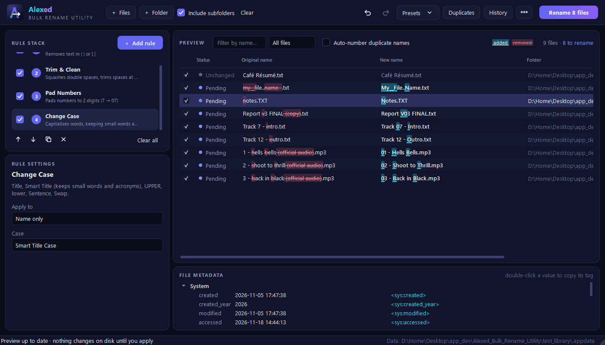
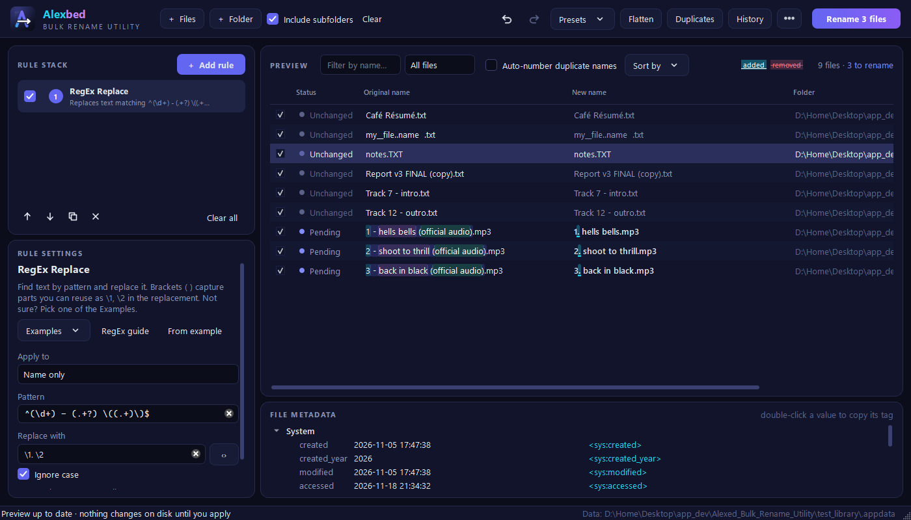
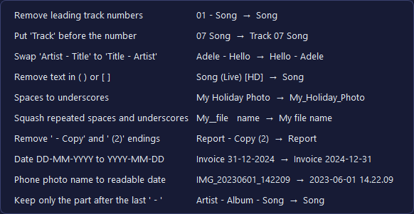
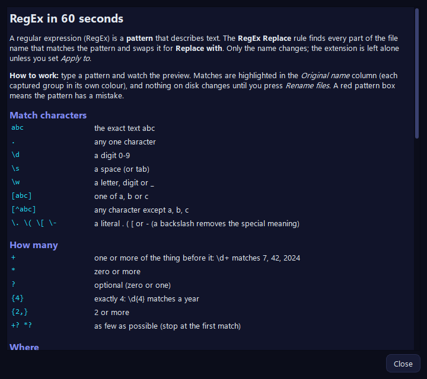

# Alexed Bulk Rename Utility


A portable, transactional bulk file renamer for big music libraries, photo and video folders and deeply nested document archives.
It's a single `.exe` for Windows 10/11, with no installer and no registry footprint.

**Version:** 1.0.0 &nbsp;|&nbsp; **Author:** Alexander Bediako &nbsp;|&nbsp; **Licence:** [GPL-3.0-or-later](LICENSE)



- **See every change before it happens.** The preview updates as you type. Added text is highlighted in cyan, and removed text is struck through in red.
- **Nothing touches the disk until you press Rename.** Renames run as one transaction: if anything fails, everything is rolled back.
- **Undo any batch later,** even after closing the app.
- **Rename from tags:** ID3/FLAC/MP4 audio tags, video tags, EXIF dates and PDF/Office properties.
- **Fast with big folders:** 10,000 files preview in a fraction of a second.
- **Find duplicate files** by content, not by name, and set the extra copies aside safely.

## Download

Get `AlexedBulkRename.exe` from the [latest release](../../releases/latest) and run it. No install is needed.
Windows SmartScreen may warn about an unknown publisher, because the exe isn't code-signed. Choose *More info → Run anyway*.

## Run from source

```powershell
python -m venv .venv
.venv\Scripts\pip install -r requirements-dev.txt
.venv\Scripts\python run.py            # or: python -m alexed_bru
```

To build the portable executable (runs the tests first), run `build.ps1`. The output is `dist\AlexedBulkRename.exe`:

```powershell
powershell -ExecutionPolicy Bypass -File build.ps1
```

History, presets and settings are stored in `AlexedBRU_data\` next to the exe. Copy both together to take your setup to another PC.
Set `ALEXED_BRU_DATA` to store them somewhere else.

## Using it

1. Drop files or folders onto the window (subfolders are included if that box is ticked).
2. Add rules on the left. They run top to bottom. Drag to reorder, untick to bypass.
3. The preview updates as you type:
   - *New name*: added or changed characters are highlighted in **cyan**.
   - *Original name*: characters that will be removed are **struck through in red**.
   - While a RegEx or Find & Replace rule is selected, *Original name* shows what it matches instead, with each capture group in its own colour.
   - Status dots: blue = will rename, amber = warning, red = error (skipped).
4. Click **Rename N files**. You can undo any batch later from **History**, even after restarting the app.

## Duplicate files

Click **Duplicates** to find files in the list that have exactly the same content, even when their names differ (`song.mp3` and `song (1).mp3`, or `IMG_2041.jpg` and `Holiday beach.jpg`).

- Files are compared by size first, then by a hash of their content, so only same-size files are read. Empty files are ignored.
- In each group, the copy with the original-looking name (not "(1)" or "- Copy"), then the oldest one, is kept. The rest are ticked. You can change the ticks, but each group always keeps at least one file.
- **Move to _Duplicates folder** moves the ticked copies into a `_Duplicates` folder next to them. It works on every drive, including USB and SD cards, and you can undo it from **History**. Later scans skip `_Duplicates` folders.
- **Move to Recycle Bin** only works on this PC's own drives. USB/SD cards and network drives have no Recycle Bin (Windows would delete the files permanently), so files there are left alone. Recycled files can be restored from the Recycle Bin, not from History.

Nothing is ever deleted permanently.

## Regular expressions (RegEx)

New to RegEx? Open a **RegEx Replace** rule:

- **Examples** fills in a ready-made pattern, such as removing track numbers, swapping "Artist - Title", or turning `IMG_20230601_142209` into a date. You see the result in the preview straight away.
- **RegEx guide** opens a cheat sheet. The same guide is in [docs/REGEX_GUIDE.md](docs/REGEX_GUIDE.md).
- **From example** writes the pattern for you: pick a file and type how its name should look (for example `Adele - Hello` → `Hello - Adele`). It shows the pattern and how many files it matches before you use it. Files with a different shape are left unchanged. See [Generate a pattern from an example](docs/REGEX_GUIDE.md#generate-a-pattern-from-an-example).



| Examples menu | RegEx guide |
|---|---|
|  |  |

| Shortcut | Action |
|---|---|
| Ctrl+O / Ctrl+Shift+O | Add files / folder |
| Ctrl+Enter | Apply renames |
| Ctrl+Z / Ctrl+Y | Undo / redo rule edits |
| Ctrl+H | Rename history (undo applied batches) |
| Ctrl+S | Save preset |
| Ctrl+F | Filter the preview |
| Delete | Remove selected files / rule |

## Rules

| Rule | What it does |
|---|---|
| Find & Replace | Replace all / first / last occurrence. Leave the replacement empty to delete the text |
| RegEx Replace | Python regex with live group highlighting; `\1`, `\g<name>`, `$1` |
| Add Prefix / Suffix | Text or tags before/after the name; won't add the same text twice |
| Change Case | Title, Smart Title, UPPER, lower, Sentence, Swap |
| Insert Text | At any position from the start or end |
| Remove | Character range, specific characters, digits, symbols, `(…)`/`[…]` text, accents |
| Trim & Clean | Whitespace, `_`/`.` to spaces, cut N characters |
| Pad Numbers | `Track 7` → `Track 07` |
| Counter / Numbering | Prefix, suffix, replace name, insert, **renumber existing numbers**; start, step, padding, restart per folder |
| New Name from Template | Build the whole name from tags |
| Extension | lower / UPPER / replace / append / remove |

Every rule can target the name, the extension, or both, and works on any file type.

## Supported metadata

| Kind | Formats | Examples |
|---|---|---|
| Audio | MP3 (ID3v1/v2), FLAC, OGG/Opus, M4A/AAC, WMA, WAV, AIFF, APE, WavPack, DSF | artist, album, title, track, disc, year, genre, bitrate, duration |
| Video | MP4, M4V, MOV, 3GP (iTunes tags, QuickTime atoms, iPhone `mdta` keys) | title, show, season, episode, date recorded, make/model, resolution, quality (1080p) |
| Documents | PDF, DOCX/XLSX/PPTX (+ macro variants) | title, author, subject, created, modified, pages |
| Images | JPEG, TIFF, PNG, WebP, HEIC*, DNG* (EXIF) | date taken, camera make/model, width/height, ISO |
| Any file | system | created, modified, size, parent/grandparent folder |

\* if Pillow can open it. MKV/AVI/WebM tags aren't read yet; system tags still work for them.

## Tags

You can use tags in any field that has a ‹› button: Template, Replace with, Insert.

| Tag | Meaning |
|---|---|
| `<name>` `<ext>` `<folder>` | Original name, extension, parent folder |
| `<num:3>` `<fnum:2>` | Position in batch / in folder, zero-padded |
| `<artist>` `<album>` `<title>` `<track:2>` `<year>` `<genre>` | **Smart tags.** Audio tags first, then document/EXIF data, then file dates |
| `<show>` `<season:2>` `<episode:2>` `<quality>` `<resolution>` `<duration>` | Video tags |
| `<date:%Y-%m-%d>` `<created:…>` `<modified:…>` | Dates with any strftime format |
| `<audio:key>` `<doc:key>` `<exif:key>` `<sys:key>` | Explicit namespace. See the *File metadata* panel for every key |

Tag values are cleaned up automatically: `AC/DC` becomes `AC-DC`, never a path separator.


Regex replacements accept `\1`, `\g<name>` and `$1`.

## Using the engine without the UI

```python
from alexed_bru.core.engine import RenameEngine
from alexed_bru.skills.rules import RegexRule, TemplateRule

engine = RenameEngine([RegexRule(pattern=r"^(\d+)\s*", replacement=r"Track \1 - ")])
for row in engine.preview(paths):
    print(row.original, "→", row.proposed, row.status.label, row.message)
engine.apply(paths)   # two-phase, rolls back on any failure
```

## Project docs

- [docs/REGEX_GUIDE.md](docs/REGEX_GUIDE.md): RegEx cheat sheet, worked example and recipes
- [docs/RESEARCH.md](docs/RESEARCH.md): competitive analysis, the UX flaws we fix, feature checklist
- [docs/ARCHITECTURE.md](docs/ARCHITECTURE.md): stack, layout, data flow, safety model, how to add skills

Tests: `.venv\Scripts\python -m pytest` (about 10s). The real 10,000-file rename/undo runs are marked slow: `.venv\Scripts\python -m pytest -m slow` (a few minutes; on this PC rename and undo each took about 4s, the rest is creating the files).

## Licence

Alexed Bulk Rename Utility is free software, released under the **GNU General Public License v3.0 or later**.
You may use, study, share and change it. See [LICENSE](LICENSE).

It's built with free software such as Qt/PySide6, mutagen, pypdf and Pillow.
Their licences are listed in [THIRD-PARTY-NOTICES.txt](THIRD-PARTY-NOTICES.txt).
